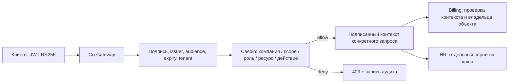

# Tenant Access Gateway

[](https://github.com/Sultanbro/tenant-access-gateway/actions/workflows/checks.yml)

**Go · Casbin · JWT/RS256 · Reverse proxy · Hierarchical RBAC · Docker**

API gateway для нескольких компаний: доступ ограничивается компанией, уровнем оргструктуры, сервисом, ресурсом и CRUD-действием. Роли наследуют права; явные запреты имеют приоритет. Политики можно менять без остановки сервера.

Практический backend-проект с воспроизводимым демо: две компании, четыре уровня доступа, два внутренних сервиса и HTTP-сценарии, проверяющие разрешённые и запрещённые операции.

## Быстрый запуск

Нужны Docker Compose, Python 3 и OpenSSL. В демо нет внешних аккаунтов или заранее опубликованных секретов.

```sh
git clone https://github.com/Sultanbro/tenant-access-gateway.git
cd tenant-access-gateway
python3 scripts/setup.py
docker compose up --build -d
curl http://localhost:8085/health
python3 scripts/demo.py
```

Дождитесь `{"message":"ok"}` перед запуском демо. Скрипт проверяет **18 HTTP-сценариев**: наследование, CRUD, изоляцию компаний и команд, доступ к HR, явный запрет, чужой объект, подменённые заголовки и просроченный токен.

Настройка создаёт `.env`, локальную RSA-пару и отдельный ключ для каждого upstream. Приватный RSA-ключ используется только демонстрационным клиентом; gateway получает публичную часть. В Git эти файлы не попадают. Повторная настройка сохраняет существующие ключи.

`docker compose down` останавливает демо. Счета в демонстрационном upstream хранятся в памяти и сбрасываются после перезапуска.

## Как проходит запрос



Публичный маршрут:

```text
/v1/tenants/{company}/scopes/{scope}/services/{service}/{resource-path}
```

Пример: `GET /v1/tenants/acme/scopes/team-a/services/billing/invoices/invoice-1`.

JWT должен содержать `sub`, `tenant`, `iss`, `aud`, `exp`. Gateway принимает только RS256, проверяет issuer/audience и совпадение компании в токене и URL. Роли берутся из серверной политики; клиент не может выдать себе роль через JWT или `X-Roles`.

## Модель доступа

1. **Компания:** отдельный домен. Один и тот же пользователь может быть reader в Acme и manager в Globex.
2. **Оргструктура:** дерево произвольных именованных областей — например, `root → division → team-a`. В конфигурации допускается до 16 уровней.
3. **Сервис:** компания должна иметь сервис в своём списке включённых сервисов.
4. **Ресурс и действие:** например, `billing / invoices / read`, `create`, `update`, `delete`.

Роль может наследовать несколько других ролей. Привязка роли к пользователю содержит scope и флаг `descendants`: права действуют только в этом scope либо в нём и дочерних. Они не поднимаются к родителю и не переходят к соседним веткам.

Доступ разрешён, только если есть подходящее разрешение и **нет ни одного подходящего запрета**. Неизвестные роли, компании, scopes, сервисы и незарегистрированные маршруты не дают доступ. Автоматического суперпользователя нет.

### Матрица демонстрации

| Пользователь | Компания / область | Доступ |
| --- | --- | --- |
| `alice` | Acme / division и команды | Чтение счетов |
| `alice` | Globex / root | Все CRUD-действия со счетами |
| `bob` | Acme / только team-a | Чтение, создание, изменение счетов |
| `carol` | Acme / всё дерево | Manager; отдельный запрет удаления в team-a |
| `helen` | Acme / всё дерево | Только чтение HR |

Сервис проверяет объект повторно: разрешение читать счета в team-a не открывает счёт другой компании или другой команды. Проверка gateway не заменяет проверку принадлежности данных в самом сервисе.

## Изменение прав и подключение сервисов

Вся конфигурация — в [`config/policy.json`](config/policy.json).

Пример отдельного права:

```json
{"service":"billing","resource":"invoices","action":"delete","effect":"deny"}
```

Пример назначения роли:

```json
{"subject":"bob","role":"editor","scope":"team-a","descendants":false}
```

`service`, `resource` и `action` в разрешении могут быть `*`; wildcard не отменяет границу компании, scope или список включённых сервисов. Для scope wildcard не используется — распространение задаётся явно через `descendants`.

Чтобы добавить компанию, опишите её services, scopes, roles и bindings. Чтобы подключить сервис:

1. Добавьте его origin URL и явный список маршрутов в `services`.
2. Укажите HTTP-метод, шаблон пути, ресурс и CRUD-действие для каждого маршрута. Поддерживаются точные сегменты и `{id}`; конфликтующие шаблоны отклоняются.
3. Включите сервис нужной компании и назначьте права её ролям.
4. Добавьте отдельный случайный ключ сервиса в `UPSTREAM_KEYS_JSON` и настройте проверку контекста на стороне сервиса. Новый ключ требует перезапуска gateway.

Обновление существующих политик:

```sh
docker compose exec gateway gateway check
docker compose kill -s SIGHUP gateway
```

Конфигурация полностью проверяется и компилируется перед атомарной заменой. Ошибка, цикл или неизвестная ссылка оставляют предыдущую политику активной. Уже выполняющийся запрос завершается с исходной версией; последующие используют новую. Изменяйте `version` вместе с политикой — она попадает в аудит.

## Границы доверия и поведение proxy

- Gateway пересылает только разрешённые заголовки: `Accept`, `Content-Type`, `If-Match`, `Idempotency-Key`. Клиентские cookies, роли, identity/proxy-заголовки и исходный bearer-токен не передаются.
- Внутренний JWT живёт 30 секунд и привязан к сервису, компании, scope, пользователю, HTTP-методу и пути. У Billing и HR разные ключи; повторяемость бизнес-операций должен контролировать сам сервис.
- Upstream URL задаёт оператор в конфигурации, а не клиент. Это не открытый proxy. Автоматических повторов записи и переходов по редиректам нет.
- Кодированные и неоднозначные пути отклоняются до маршрутизации. Размер тела — до 1 MiB, общий deadline обращения к upstream — 5 секунд, одновременно обрабатывается до 128 запросов.
- Upstream-ошибки возвращаются без внутренних подробностей. Аудит содержит request ID, субъект, компанию, scope, ресурс, действие, решение, статус, версию политики и длительность; тела и токены не логируются.
- В Docker наружу опубликован только gateway на loopback; upstream-сервисы находятся во внутренней сети. Контейнеры работают без root и с файловой системой только для чтения.

Ответы: `401` — токен; `403` — запрет; `404` — незарегистрированный маршрут/чужой объект; `400` — неоднозначный URL; `413` — размер; `429` — заполнен лимит одновременных запросов; `502/504` — upstream/таймаут.

## Проверки и локальная разработка

Go 1.27.2+:

```sh
go test -race -cover ./...
go vet ./...
```

[`internal/policy`](internal/policy) проверяет матрицу прав, циклы и конфликтующие маршруты. [`internal/auth`](internal/auth) проверяет алгоритм, issuer, audience, expiry и контекст сервиса. [`internal/gateway`](internal/gateway) проверяет HTTP-границы, подмену заголовков, таймауты, размер тела и конкурентную смену политики. Демо в CI отдельно запускает настоящие процессы gateway, Billing и HR.

Для запуска без Docker экспортируйте `.env`, задайте `UPSTREAM_BILLING` и `UPSTREAM_HR` с локальными адресами, запустите два экземпляра `cmd/billing` с соответствующими `SERVICE_NAME`, `LISTEN_ADDR`, `INTERNAL_SIGNING_KEY`, затем `go run ./cmd/gateway`. Основные переменные gateway: `JWT_PUBLIC_KEY_FILE`, `JWT_ISSUER`, `JWT_AUDIENCE`, `UPSTREAM_KEYS_JSON`, `POLICY_FILE`, `LISTEN_ADDR`.

## Осознанные ограничения

Это API gateway и модель политик, а не полноценный IAM-продукт. Вход пользователей, MFA, автоматическая ротация JWKS, UI управления ролями и централизованное хранилище политик сюда не входят. Для внешнего размещения нужны TLS, реальный issuer, защищённое управление ключами, ограничения частоты запросов и централизованный аудит. Несколько экземпляров требуют согласованной доставки версий политики. Billing/HR — демонстрационные адаптеры, не производственные системы учёта.

## Источники решений

- [OWASP Authorization](https://cheatsheetseries.owasp.org/cheatsheets/Authorization_Cheat_Sheet.html): запрет по умолчанию и проверка каждого запроса.
- [Casbin RBAC](https://www.casbin.org/docs/rbac): роли, наследование и разделение имён пользователей/ролей.
- [JWT validation](https://golang-jwt.github.io/jwt/usage/parse/) и [Go ReverseProxy](https://pkg.go.dev/net/http/httputil).

MIT License.
